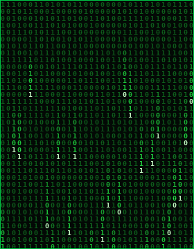

<div align="center">




<br/>

<a href="https://linkedin.com/in/Mohd-Faiz"></a>
<a href="https://instagram.com/faiz_sayeed_"></a>
<a href="https://leetcode.com/u/ShaikMohdFaizSayeed/"></a>
<a href="https://mastodon.social/@Mohd_Faiz_Sayeed"></a>
<a href="mailto:faizsayeed16556@gmail.com"></a>

<br/><br/>


</div>

---

<div align="center">

## `> ./whoami`

<table>
<tr>
<td valign="middle" align="center">



</td>
<td valign="middle">

```text
faiz@github:~$ cat about.txt

name     : Mohd Faiz Sayeed
role     : B.Tech CSE (Data Science)
college  : NMIMS, 2nd Year
location : Telangana, India
focus    : AI | ML | Data Science
           Full-Stack Development
status   : Learning. Building.
           Improving.

faiz@github:~$ _
```

</td>
</tr>
</table>

</div>

---

## 👋 Hello, I'm Faiz

> **B.Tech CSE (Data Science) @ NMIMS** · 2nd Year · AI & Data Science Enthusiast · Builder

I'm passionate about **Artificial Intelligence, Data Science, Machine Learning and Full-Stack Development**.
I enjoy taking an idea from **raw data → model → application → real-world impact**.

Right now I'm strengthening my foundations in **Python, SQL, Machine Learning, Deep Learning, Data Visualization and Cloud**, while building practical projects along the way.

<div align="center">

| 🧠 AI & ML | 📊 Data Science | 💻 Development | ☁️ Cloud |
| :---: | :---: | :---: | :---: |
| Machine Learning | Data Analysis | Full-Stack Apps | Cloud for AI |
| Deep Learning | Visualization | REST APIs | Deployment |
| Generative AI | Power BI | Backend Systems | DevOps Basics |

</div>

---

## 🚀 What I'm Currently Building

<div align="center">
<table>
<tr>
<td width="33%" align="center" valign="top">

### 🤖 AI / ML

Practical machine-learning applications, plus exploring deep learning and generative AI.

</td>
<td width="33%" align="center" valign="top">

### 📊 Data Science

Finding patterns in datasets, building visualizations and generating insights.

</td>
<td width="33%" align="center" valign="top">

### 🌐 Full Stack

Interactive applications that connect modern frontends with powerful backends.

</td>
</tr>
</table>
</div>

---

## 🧑‍💻 About Me

<table>
<tr>
<td width="50%" valign="top">

### 🌱 Currently Learning

- Python & SQL
- Machine Learning & Deep Learning
- Data Visualization & Power BI
- Cloud Computing
- Generative AI & LLM Applications
- MLOps

</td>
<td width="50%" valign="top">

### 🎯 Open To

- Open Source
- AI / Data Science / ML Projects
- Full-Stack Development
- Hackathons
- Technical Collaborations

### 💬 Ask Me About

Python · C++ · Pandas · NumPy · Data Visualization · Git & GitHub · Problem Solving

</td>
</tr>
</table>

---

## 🛠️ Tech Stack

<div align="center">

| Category | Technologies |
| :---: | :--- |
| **👨‍💻 Programming** |  |
| **🤖 AI / ML** |  <br/>     |
| **🌐 Web** |  |
| **🗄️ Databases** |   |
| **☁️ Cloud & Deploy** |  <br/>    |
| **🔧 Tools** |  <br/>     |

</div>

---

## 🚀 Featured Projects

<table>
<tr>
<td width="50%" valign="top">

### 🌦️ WeatherGPT
**AI-powered weather intelligence platform**

> Weather data + AI + interactive UI

- 🌍 Real-time weather information
- 🤖 AI-powered responses
- 📊 Weather analytics
- 🗺️ Location-based information
- 🌐 Modern web interface

`Python` `FastAPI` `React` `AI` `APIs`

</td>
<td width="50%" valign="top">

### 🧠 Machine Learning Projects
**Exploring practical ML applications**

- 📈 Predictive modelling
- 🧹 Data preprocessing
- 🧠 Classification
- 🎯 Regression
- ⚙️ Model evaluation

`Python` `Pandas` `NumPy` `Scikit-Learn`

</td>
</tr>
<tr>
<td width="50%" valign="top">

### 📊 Data Analytics
**Turning raw datasets into insights**

- Data cleaning & EDA
- Visualization
- Dashboard development
- Business insights

`Python` `Pandas` `Matplotlib` `Power BI` `SQL`

</td>
<td width="50%" valign="top">

### 🌐 Full-Stack Applications
**Useful end-to-end applications**

- Frontend interfaces
- REST APIs & backend services
- Database integration
- Deployment

`JavaScript` `Angular` `Node.js` `Flask` `SQL`

</td>
</tr>
</table>

> 💡 More projects are being built and will be added here as they become production-ready.

---

## 📊 GitHub Analytics

<div align="center">


<br/><br/>


<br/><br/>


</div>

---

## 🧩 My Development Philosophy

<div align="center">

### **Learn → Build → Break → Debug → Improve → Repeat**

</div>

I believe the fastest way to improve as a developer is to **build things slightly beyond your current skill level**. My goal isn't just to learn technologies, but to understand **why and how they work, and where they solve real problems.**

---

## 🎯 2026 Goals

- [ ] Build more production-quality AI applications
- [ ] Strengthen Machine Learning fundamentals
- [ ] Learn Deep Learning properly
- [ ] Explore Generative AI & LLM applications
- [ ] Improve SQL & Data Structures
- [ ] Build advanced data dashboards
- [ ] Contribute to Open Source
- [ ] Participate in more hackathons
- [ ] Deploy more projects to the cloud
- [ ] Improve competitive programming
- [ ] Build a strong portfolio of real-world projects

---

## 🤝 Let's Collaborate

I'm always interested in projects involving:

```text
Artificial Intelligence  |  Machine Learning  |  Data Science
Generative AI            |  LLM Applications  |  Data Visualization
Full-Stack Development   |  Open Source       |  Hackathons
```

If you're building something interesting, **let's connect and build it together.**

---

## 📫 Connect With Me

<div align="center">

<a href="mailto:faizsayeed16556@gmail.com"></a>
<br/><br/>
<a href="https://linkedin.com/in/Mohd-Faiz"></a>
<a href="https://leetcode.com/u/ShaikMohdFaizSayeed/"></a>
<a href="https://instagram.com/faiz_sayeed_"></a>

<br/><br/>

### ⭐ If you find my work interesting, consider following me!
### **Thanks for visiting my profile! 👋**


</div>
